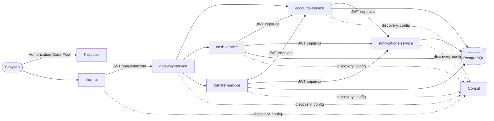

# my-bank-app

Микросервисное приложение «Банк» на Spring Boot 3.5 и Spring Cloud 2025.0 (Java 21, Maven).

Пользователь входит через сервер авторизации Keycloak и на одной странице может:

- изменить фамилию, имя и дату рождения своего аккаунта;
- положить виртуальные деньги на счёт и снять их;
- перевести деньги на счёт другого клиента.

О каждой операции сервис уведомлений пишет сообщение в лог и сохраняет его в БД.

## Содержание

- [Архитектура](#архитектура)
- [Модули и порты](#модули-и-порты)
- [Авторизация](#авторизация)
- [Паттерны](#паттерны)
- [Требования](#требования)
- [Сборка и тесты](#сборка-и-тесты)
- [Запуск в Docker Compose](#запуск-в-docker-compose)
- [Локальный запуск](#локальный-запуск)
- [REST API](#rest-api)
- [Базы данных](#базы-данных)

## Архитектура



- **front-ui** — Spring Web MVC + Thymeleaf. Страница доступна только после входа через Keycloak.
  Все запросы фронт выполняет в Gateway API, добавляя access token вошедшего пользователя.
- **gateway-service** — Spring Cloud Gateway (WebFlux). Проверяет JWT пользователя, передаёт заголовок
  `Authorization` в микросервисы без изменений и маршрутизирует запросы через Service Discovery (`lb://`).
  Наружу открыты только пользовательские операции: `/api/accounts`, `/api/accounts/me`, `/api/cash`, `/api/transfer`.
- **accounts-service** — аккаунты и счета: логин, фамилия и имя, дата рождения, сумма на счёте.
- **cash-service** — пополнение счёта и снятие денег через accounts-service.
- **transfer-service** — перевод денег между счетами через accounts-service.
- **notifications-service** — приём уведомлений от сервисов.
- **Consul** — Service Discovery (`spring-cloud-starter-consul-discovery`) и Distributed Config
  (`spring-cloud-starter-consul-config`). Общие настройки всех сервисов лежат в ключе `config/application/data`
  (файл [consul/application.yml](consul/application.yml)).
- **Keycloak** — сервер авторизации OAuth 2.0 / OpenID Connect, realm `bank` импортируется из
  [keycloak/realm-bank.json](keycloak/realm-bank.json).
- **PostgreSQL** — одна база `bank`, у каждого сервиса своя схема (Database per Service).

Микросервисы вызывают друг друга напрямую, находя адрес через Consul (`@LoadBalanced RestClient`),
а не через Gateway API.

## Модули и порты

| Модуль                  | Порт | Назначение                                  |
|-------------------------|------|---------------------------------------------|
| `front-ui`              | 8080 | веб-интерфейс клиента банка                 |
| `gateway-service`       | 8090 | Gateway API                                 |
| `accounts-service`      | 8091 | аккаунты и счета                            |
| `cash-service`          | 8092 | внесение и снятие денег                     |
| `transfer-service`      | 8093 | переводы между счетами                      |
| `notifications-service` | 8094 | уведомления                                 |
| Keycloak                | 8180 | сервер авторизации (админка `admin`/`admin`)|
| Consul                  | 8500 | Service Discovery и конфигурация (UI)       |
| PostgreSQL              | 5433 | база `bank`, пользователь `bank`/`bank`     |

Корневой [pom.xml](pom.xml) — родительский проект: подключает BOM Spring Cloud, плагин Spring Cloud Contract
и объединяет все модули, поэтому всё собирается одной командой.

Слои внутри сервисов: `controller` (REST/MVC), `dto`, `service`, `model`, `repository` (Spring Data JDBC),
`client` (REST-клиенты других сервисов), `outbox`, `config`, `security`; у фронта дополнительно view `templates/main.html`.

## Авторизация

### Пользователи

| Логин     | Пароль     | Аккаунт       |
|-----------|------------|---------------|
| `ivanov`  | `password` | Иванов Иван   |
| `petrov`  | `password` | Петров Петр   |
| `sidorov` | `password` | Сидоров Сидор |

Аккаунты создаются миграцией accounts-service, на каждом счёте 100 руб. Аккаунт связывается с пользователем
по логину: claim `preferred_username` в JWT.

### Клиенты и привилегии

Привилегии выдаются как scope в access token (`scope` → authority `SCOPE_*` в Spring Security).

| Клиент Keycloak    | Flow                      | Scope в токене                  | Куда может обращаться             |
|--------------------|---------------------------|---------------------------------|-----------------------------------|
| `front-ui`         | Authorization Code        | `accounts`, `cash`, `transfer`  | Accounts, Cash, Transfer (через Gateway) |
| `accounts-service` | Client Credentials        | `notifications`                 | Notifications                     |
| `cash-service`     | Client Credentials        | `accounts.balance`, `notifications` | Accounts (изменение баланса), Notifications |
| `transfer-service` | Client Credentials        | `accounts.balance`, `notifications` | Accounts (изменение баланса), Notifications |

- Пользователь видит и меняет только свой аккаунт: логин берётся из токена, а не из запроса.
- Изменять баланс (`/api/accounts/{login}/deposit|withdraw`) может только сервис со scope `accounts.balance`,
  токен пользователя для этого не подходит. Gateway эти пути не публикует.
- Сервисы, которым не выдан scope, не могут обращаться друг к другу (например, Cash не может вызвать Transfer).

Сервисы получают свой токен через `OAuth2AuthorizedClientManager` (Client Credentials) и добавляют его в каждый
запрос (`ServiceTokenInterceptor`). Фронт добавляет токен пользователя через `OAuth2ClientHttpRequestInterceptor`.
Кнопка «Выйти» завершает сессию и во фронте, и в Keycloak (RP-Initiated Logout).

## Паттерны

| Паттерн | Где реализован |
|---------|----------------|
| API Gateway | `gateway-service` (Spring Cloud Gateway) |
| Service Discovery, Client-side Load Balancing | Consul + Spring Cloud LoadBalancer, `lb://` и `@LoadBalanced RestClient` |
| Externalized / Distributed Config | Consul KV, `spring.config.import=optional:consul:` |
| Access Token | JWT Keycloak, Authorization Code Flow (фронт) и Client Credentials Flow (сервисы) |
| Database per Service | отдельная схема PostgreSQL на сервис, миграции Flyway |
| Circuit Breaker | Spring Cloud CircuitBreaker + Resilience4j в клиентах сервисов и фильтр `CircuitBreaker` в Gateway |
| Transactional Outbox | таблица `outbox_notifications`: уведомление сохраняется в одной транзакции с операцией, `NotificationOutboxPublisher` отправляет его в Notifications |
| Saga (компенсация) | `TransferService`: при ошибке зачисления получателю деньги возвращаются отправителю |
| UI Composition | `MainPageService` собирает страницу из ответов сервиса аккаунтов |
| Remote Procedure Invocation | REST + JSON между сервисами |
| Consumer-Driven Contract Testing | Spring Cloud Contract: контракты у сервисов-поставщиков, заглушки у потребителей |
| Single Service per Host | отдельный Docker-контейнер на каждый сервис |

## Требования

- JDK 21+
- Docker (для Testcontainers в тестах и для запуска в Docker Compose)

Maven устанавливать не нужно — в проекте есть Maven Wrapper.

## Сборка и тесты

Сборка всех модулей и прогон тестов одной командой:

```bash
./mvnw clean verify
```

Executable JAR каждого модуля появляется в `<модуль>/target/<модуль>.jar`.
Сборка без тестов:

```bash
./mvnw clean package -DskipTests
```

### Тесты

- **Юнит-тесты** (JUnit 5, Mockito): сервисы, сага перевода, outbox, валидатор возраста, REST-клиенты
  (`MockRestServiceServer`), обработчик выхода.
- **Интеграционные тесты** (`@SpringBootTest`, MockMvc, Testcontainers PostgreSQL): API сервисов вместе с БД,
  правами доступа и валидацией. Общие настройки вынесены в базовые классы `IntegrationTestBase`,
  поэтому контекст Spring создаётся один раз на модуль и переиспользуется (кеширование контекстов TestContext Framework).
- **Контрактные тесты** (Spring Cloud Contract):
  - контракты поставщиков лежат в `src/test/resources/contracts` сервисов notifications, accounts, cash и transfer;
    плагин генерирует по ним тесты поставщика (`ContractVerifierBase`) и jar с заглушками WireMock (`*-stubs.jar`);
  - потребители запускают заглушки через `@AutoConfigureStubRunner`, Stub Runner регистрирует их в Service Discovery:
    accounts, cash, transfer проверяют клиент Notifications; cash и transfer — клиент Accounts;
    gateway — маршрутизацию; фронт — работу страницы с Accounts, Cash и Transfer.

Тестам не нужны Consul и Keycloak: Consul отключён в настройках Surefire, JWT подменяется `spring-security-test`.

## Запуск в Docker Compose

```bash
docker compose up -d --build
```

Compose поднимает PostgreSQL, Consul, загрузчик общих настроек в Consul KV, Keycloak и все сервисы.
Образы собираются из исходников внутри Docker (multi-stage build), предварительная сборка Maven не нужна.
Первый запуск занимает несколько минут: скачиваются зависимости и Keycloak импортирует realm.

После старта:

- фронт — http://localhost:8080 (вход `ivanov` / `password`);
- Consul UI — http://localhost:8500 (зарегистрированные сервисы и ключ `config/application/data`);
- Keycloak — http://localhost:8180 (`admin` / `admin`).

На macOS при первом запуске Docker Desktop может запросить доступ к папке проекта
(realm Keycloak и настройки Consul монтируются из неё) — без разрешения контейнеры не стартуют.

Остановить и удалить контейнеры (с данными БД):

```bash
docker compose down -v
```

Собрать и запустить один сервис вручную:

```bash
docker build -f accounts-service/Dockerfile -t my-bank/accounts-service .
```

```bash
docker run --rm -p 8091:8091 --network my-bank-app_default -e CONSUL_HOST=consul -e DB_HOST=postgres -e KEYCLOAK_URL=http://keycloak:8080 my-bank/accounts-service
```

## Локальный запуск

1. Поднять инфраструктуру:

   ```bash
   docker compose up -d postgres consul consul-config-loader keycloak
   ```

2. Собрать проект:

   ```bash
   ./mvnw clean package -DskipTests
   ```

3. Запустить сервисы (каждый в своём терминале или из IDE через main-класс модуля):

   ```bash
   java -jar notifications-service/target/notifications-service.jar
   ```

   ```bash
   java -jar accounts-service/target/accounts-service.jar
   ```

   ```bash
   java -jar cash-service/target/cash-service.jar
   ```

   ```bash
   java -jar transfer-service/target/transfer-service.jar
   ```

   ```bash
   java -jar gateway-service/target/gateway-service.jar
   ```

   ```bash
   java -jar front-ui/target/front-ui.jar
   ```

4. Открыть http://localhost:8080.

По умолчанию сервисы ищут Consul, PostgreSQL и Keycloak на `localhost`. Адреса меняются переменными окружения:

| Переменная            | По умолчанию            | Назначение                                  |
|-----------------------|-------------------------|---------------------------------------------|
| `CONSUL_HOST`         | `localhost`             | адрес Consul                                |
| `DB_HOST`, `DB_PORT`  | `localhost`, `5433`     | адрес PostgreSQL                            |
| `KEYCLOAK_URL`        | `http://localhost:8180` | адрес Keycloak для сервисов                 |
| `KEYCLOAK_PUBLIC_URL` | `http://localhost:8180` | адрес Keycloak для браузера и issuer токенов|

## REST API

Все запросы требуют заголовок `Authorization: Bearer <JWT>`.

| Сервис        | Метод и путь                          | Scope              | Описание |
|---------------|---------------------------------------|--------------------|----------|
| Accounts      | `GET /api/accounts/me`                | `accounts`         | данные своего аккаунта |
| Accounts      | `PUT /api/accounts/me`                | `accounts`         | изменить фамилию, имя и дату рождения (`{"name", "birthdate"}`) |
| Accounts      | `GET /api/accounts`                   | `accounts`         | логины, фамилии и имена других клиентов |
| Accounts      | `POST /api/accounts/{login}/deposit`  | `accounts.balance` | зачислить деньги (`{"amount"}`) |
| Accounts      | `POST /api/accounts/{login}/withdraw` | `accounts.balance` | списать деньги (`{"amount"}`) |
| Cash          | `POST /api/cash`                      | `cash`             | `{"action": "DEPOSIT" \| "WITHDRAW", "amount"}` |
| Transfer      | `POST /api/transfer`                  | `transfer`         | `{"toLogin", "amount"}` |
| Notifications | `POST /api/notifications`             | `notifications`    | `{"login", "message"}` |

Ошибки возвращаются в формате `{"errors": ["..."]}`: 400 — невалидные данные (в том числе возраст младше 18 лет),
404 — аккаунт не найден, 409 — недостаточно средств, 503 — сервис аккаунтов недоступен.

## Базы данных

Схемы создаёт Flyway при старте сервиса (`src/main/resources/db/migration`).

| Схема           | Таблицы |
|-----------------|---------|
| `accounts`      | `accounts` (login, name, birthdate, balance), `outbox_notifications` |
| `cash`          | `cash_operations` (login, action, amount, balance, created_at), `outbox_notifications` |
| `transfer`      | `transfers` (from_login, to_login, amount, status, created_at), `outbox_notifications` |
| `notifications` | `notifications` (login, message, created_at) |

Баланс меняется одним `UPDATE ... WHERE balance >= :amount`, поэтому одновременные списания не уводят счёт в минус;
дополнительно на столбце стоит `CHECK (balance >= 0)`.
